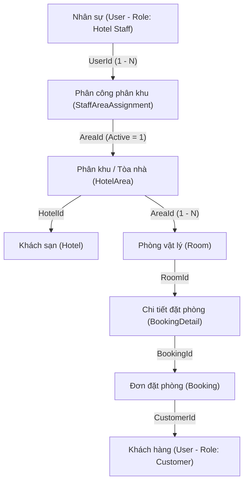

# Báo Cáo Thiết Kế & Triển Khai Phân Quyền Staff Theo Hotel/Area và Chống IDOR Booking

---

## 1. Tổng quan & Mục tiêu

Trong hệ thống đặt phòng khách sạn trực tuyến (**Hotel Booking Management System**), việc kiểm soát truy cập và bảo vệ dữ liệu khách hàng là ưu tiên hàng đầu. Hai rủi ro an ninh nghiêm trọng cần được giải quyết triệt để gồm:

1. **Lỗ hổng IDOR (Insecure Direct Object Reference)**:
   - Xảy ra khi người dùng (Khách hàng) có thể xem trộm thông tin, danh sách lịch sử hoặc tự ý hủy đơn đặt phòng của người khác chỉ bằng cách thay đổi tham số `bookingId` hoặc `customerId` trên URL/Request.
2. **Vi phạm ranh giới quản trị (Broken Object-Level Authorization - BOLA)**:
   - Xảy ra khi Nhân viên lễ tân (**Hotel Staff**) của Tòa A / Khách sạn 1 có thể can thiệp, xem hoặc thực hiện Check-in / Đổi trạng thái các đơn đặt phòng thuộc Tòa B hoặc Khách sạn khác mà mình không được phân công phụ trách.

Báo cáo này giải thích toàn bộ giải pháp kỹ thuật đã được triển khai vào mã nguồn theo chuẩn kiến trúc **Clean Architecture** của dự án.

---

## 2. Mô hình quan hệ dữ liệu liên kết

Hệ thống xác định quyền hạn của Nhân viên dựa trên phân khu phụ trách (`HotelArea`) theo chuỗi liên kết sau:



- **Một đơn đặt phòng (`Booking`)** chứa một hoặc nhiều phòng (`BookingDetails` -> `RoomId`).
- **Mỗi phòng (`Room`)** thuộc về một phân khu (`AreaId` của `HotelArea`).
- **Mỗi nhân viên lễ tân (`Staff`)** được phân công một hoặc nhiều phân khu thông qua bảng `StaffAreaAssignments` (với `IsActive = 1`).
- **Nhân viên chỉ có quyền thao tác** trên đơn đặt phòng nếu các phòng trong đơn đó thuộc phân khu mà nhân viên đang được phân công.

---

## 3. Các biện pháp kỹ thuật đã triển khai

### 3.1. Chống IDOR cho Khách hàng (Customer)

| Thao tác | Trước khi sửa (Lỗ hổng) | Sau khi sửa (Bảo mật) |
| :--- | :--- | :--- |
| **Tạo đơn (`POST /api/bookings`)** | Có nguy cơ truyền sai `customerId`. | Lấy trực tiếp `customerId = currentUserId` từ JWT Token được máy chủ xác thực. |
| **Xem chi tiết (`GET /api/bookings/{id}`)** | Bất kỳ ai biết `id` đều đọc được thông tin cá nhân của khách khác. | So sánh `booking.CustomerId == currentUserId`. Nếu không khớp, trả về **403 Forbidden**. |
| **Tra cứu mã (`GET /api/bookings/code/{code}`)** | Bất kỳ ai có mã đều xem được đơn. | Kiểm tra quyền sở hữu tương tự `GetById`. |
| **Xem danh sách (`GET /api/bookings`)** | Khách truyền `?customerId=...` để xem trộm lịch sử của người khác. | Ép buộc gán `filter.CustomerId = currentUserId` từ JWT Token. Khách hàng không thể can thiệp. |
| **Hủy đơn (`POST /api/bookings/{id}/cancel`)** | Khách A có thể hủy đơn của Khách B bằng cách gửi ID của B. | Bắt buộc `booking.CustomerId == currentUserId`. Nếu không phải chủ đơn, chặn ngay lập tức. |

---

### 3.2. Authorization cho Nhân viên (Hotel Staff) theo Hotel & Phân khu (Area)

#### A. Kiểm tra quyền ở cấp độ bản ghi đơn lẻ (Record-Level Authorization)
Khi Staff thực hiện thao tác trên một đơn cụ thể (`GetById`, `GetByCode`, hoặc `UpdateStatus`):
- Gọi phương thức `IsStaffAssignedToBookingAsync(bookingId, staffUserId)` trong Repository.
- Hệ thống kiểm tra xem các phòng trong `BookingDetails` có phòng nào thuộc `AreaId` mà nhân viên này được phân công với `IsActive = 1` hay không.
- Nếu không thuộc phân khu của nhân viên: Trả về lỗi `"Bạn không có quyền truy cập/cập nhật đơn đặt phòng ngoài phân khu được phân công."`

#### B. Lọc tự động ở cấp độ danh sách (Query-Level Authorization)
Khi Staff gọi `GET /api/bookings`:
- Hệ thống trích xuất danh sách các `assignedAreaIds` mà Staff phụ trách từ bảng `StaffAreaAssignments`.
- Lấy toàn bộ `assignedRoomIds` thuộc các Area đó.
- Lọc câu truy vấn Entity Framework:
  ```csharp
  query = query.Where(b => b.BookingDetails.Any(bd => assignedRoomIds.Contains(bd.RoomId)));
  ```
- Nếu nhân viên mới chưa được Admin phân công phân khu nào: Trả về danh sách trống (`[]`), đảm bảo không để lộ dữ liệu của các khu vực khác.

#### C. Đặc quyền Quản trị viên (Admin)
- Người dùng có Role `Admin` giữ toàn quyền giám sát, có thể xem, hủy hỗ trợ khách hàng, hoặc cập nhật mọi đơn đặt phòng trên toàn hệ thống khách sạn.

---

## 4. Chi tiết các file mã nguồn đã thay đổi

### 1. `Backend/HotelBooking.Application/Interfaces/IBookingRepository.cs`
- Thêm tham số `long? staffUserId = null` vào `GetListAsync` và `GetCountAsync`.
- Thêm định nghĩa phương thức:
  - `Task<bool> IsStaffAssignedToBookingAsync(long bookingId, long staffUserId);`
  - `Task<List<int>> GetAssignedAreaIdsAsync(long staffUserId);`

### 2. `Backend/HotelBooking.Infrastructure/Repositories/BookingRepository.cs`
- Tích hợp thêm DbContext phụ trách phân khu & phòng (`RoomPersistenceDbContext`) vào Constructor (hỗ trợ cả môi trường DI và Unit Tests).
- Cài đặt logic lọc phân khu cho Staff trong `GetListAsync` và `GetCountAsync`.
- Cài đặt `IsStaffAssignedToBookingAsync` đối chiếu trực tiếp giữa `BookingDetails.RoomId` -> `Rooms.AreaId` -> `StaffAreaAssignments.UserId`.

### 3. `Backend/HotelBooking.Application/Interfaces/IBookingService.cs`
- Cập nhật chữ ký các hàm nghiệp vụ tiếp nhận thông tin ngữ cảnh bảo mật:
  - `GetBookingByIdAsync(long bookingId, long currentUserId, bool isAdmin, bool isStaff)`
  - `GetBookingByCodeAsync(string bookingCode, long currentUserId, bool isAdmin, bool isStaff)`
  - `GetBookingsAsync(BookingFilterRequest filter, long currentUserId, bool isAdmin, bool isStaff)`
  - `CancelBookingAsync(long bookingId, long currentUserId, bool isAdmin, CancelBookingRequest request)`
  - `UpdateBookingStatusAsync(long bookingId, long staffUserId, bool isAdmin, UpdateBookingRequest request)`

### 4. `Backend/HotelBooking.Application/Services/BookingServices.cs`
- Triển khai logic kiểm tra quyền 3 lớp:
  1. **Lớp 1 (Admin)**: Toàn quyền truy cập.
  2. **Lớp 2 (Staff)**: Gọi kiểm tra phân khu `IsStaffAssignedToBookingAsync`.
  3. **Lớp 3 (Customer)**: So khớp `booking.CustomerId == currentUserId` chống IDOR.
- Chặn quyền hủy đơn nếu không phải chủ đơn hoặc Admin.
- Tự động ghi nhận thông tin nhân sự thực hiện cập nhật vào `BookingStatusHistory`.

### 5. `Backend/HotelBooking.API/Controllers/BookingController.cs`
- Xây dựng helper `GetUserContext()` trích xuất `currentUserId`, `isAdmin`, `isStaff` từ các claim JWT: `ClaimTypes.NameIdentifier`, `ClaimTypes.Role` (`Admin`, `Hotel Staff`, `Customer`).
- Hỗ trợ cơ chế dev fallback an toàn khi chạy môi trường thử nghiệm cục bộ.
- Phản hồi mã lỗi chuẩn HTTP **403 Forbidden** khi phát hiện hành vi truy cập trái phép hoặc can thiệp IDOR.

---

## 5. Bảng ma trận phân quyền hệ thống (Permission Matrix)

| Chức năng API | Khách hàng (Customer) | Nhân viên lễ tân (Hotel Staff) | Quản trị viên (Admin) |
| :--- | :--- | :--- | :--- |
| **Báo giá (`POST /calculate-price`)** | Cho phép | Cho phép | Cho phép |
| **Đặt phòng (`POST /api/bookings`)** | Tự đặt cho chính mình (`CustomerId = JWT.UserId`) | Cho phép đặt | Cho phép đặt |
| **Xem đơn (`GET /api/bookings/{id}`)** | Chỉ xem đơn của chính mình (IDOR check) | Chỉ xem đơn thuộc Phân khu phụ trách | Xem tất cả các đơn |
| **Lọc danh sách (`GET /api/bookings`)** | Chỉ thấy lịch sử của chính mình | Chỉ thấy các đơn thuộc Phân khu phụ trách | Thấy tất cả đơn toàn hệ thống |
| **Hủy đơn (`POST /api/bookings/{id}/cancel`)** | Chỉ hủy đơn của chính mình | Bị chặn (hoặc theo quy trình lễ tân) | Được phép hủy hỗ trợ |
| **Đổi trạng thái (`PATCH /api/bookings/{id}/status`)** | **Bị chặn (403 Forbidden)** | Chỉ đổi trạng thái đơn thuộc Phân khu phụ trách | Toàn quyền Check-in/Check-out |

---

## 6. Kết quả kiểm thử & Nghiệm thu

- **Biên dịch hệ thống (Build)**: `dotnet build HotelBookingManagementSystem.slnx` đạt **0 Warning(s), 0 Error(s)**.
- **Kiểm thử tự động (Unit Tests)**: Chạy `dotnet test HotelBookingManagementSystem.slnx` thành công toàn bộ **30/30 tests** trong bộ test `HotelBooking.Tests.dll`.
- **Máy chủ Backend**: Đã khởi chạy live tại `http://localhost:5131`, sẵn sàng phục vụ Frontend và kiểm thử API bảo mật.
